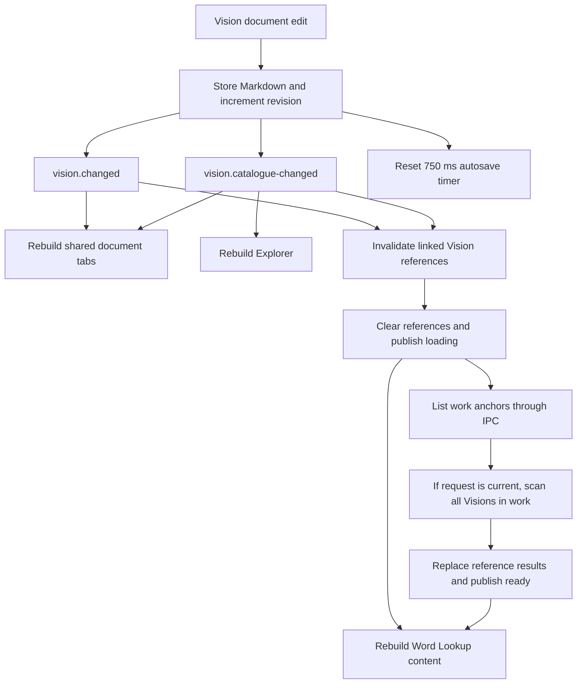

# Vision typing and renderer event report

Date: November 9, 2026

**Finding:** Ordinary Vision edits are being treated as catalogue and reference changes. This causes unrelated UI reconstruction and repeated asynchronous work. The correction is to publish precise changes and update only the DOM that depends on them. Increasing a debounce delay alone would leave the underlying problem intact.

This report records the diagnosis of the working tree before the event correction, including the uncommitted Vision and Word Lookup implementation. It is a source analysis, not a runtime performance measurement. The approved implementation is described below; no latency improvement is claimed as measured.

Implementation: Vision edits now publish distinct dirty, metadata, reference, and save-state transitions. Catalogue notifications identify creation, deletion, or reset. The unused `vision.changed` and `vision.saved` events and their old subscriptions have been removed. Word Lookup retains work-scoped anchor accelerators and updates only its linked-Visions host for affected exact occurrences. Shared document tabs and Vision Explorer rows retain their DOM identities. Existing regression scenarios have been extended to exercise these boundaries; the sections below preserve the original findings and design rationale.

Validation: TypeScript checking passed (`tsc -p tsconfig.main.json --noEmit`). All 21 tests passed across `VisionPanel`, `VisionReferenceController`, `WordVisionReferenceController`, `WordExplorationPanel`, and `WorkspacePanel`. The extended scenarios confirm no reference notification or anchor reload for ordinary prose edits, correct reference removal/restoration and title changes, and preservation of unrelated document-tab and lookup DOM nodes. No new test cases or dependencies were added. Runtime input latency has not been benchmarked.

## 1. The confirmed path from typing to unrelated updates

Write mode serializes the changed ProseMirror document in `MarkdownEditor.CreateChangePlugin`, then calls `VisionController.UpdateMarkdown`. Markdown mode reaches the same controller through CodeMirror's document-change listener.

The controller updates `VisionStore`, then calls `PublishChange`. That method publishes **both** `vision.changed` and `vision.catalogue-changed` for every changed Markdown value, and schedules autosave. The catalogue event contains only a count, even though neither membership nor count changed.

Sources: [MarkdownEditor.ts:273](../src/renderer/ui/MarkdownEditor.ts), [VisionMarkdownSourceEditor.ts](../src/renderer/visions/VisionMarkdownSourceEditor.ts), [VisionController.ts:94 and :176](../src/renderer/visions/VisionController.ts).

### Word Lookup

`WordVisionReferenceController` subscribes to both Vision events. Each delivery increments a global Vision revision, invalidates `loadedKey`, and starts `RefreshAsync` when active word evidence exists. This happens even when the edited Vision belongs to a different work.

Each refresh clears the reference store, publishes a loading notification, and calls `TextAnchorGateway.ListAsync`. The latest generation then parses the Markdown of every Vision in the lookup's work and rebuilds the reference result.

Consequently, one ordinary edit starts two reference refresh attempts. The generation guard can discard an obsolete result after the anchor request returns; it does not prevent that request or its initial loading notification. Depending on interleaving, obsolete generations skip their scans, so it would be inaccurate to claim that both scans always finish.

`WordExplorationPanel` handles every reference notification with its general `Update` method. That method synchronizes tabs, deep-clones the word snapshot, regenerates dictionary and occurrence markup, replaces the active content's `innerHTML`, reapplies column layout, and repopulates open floating panels. Occurrence rendering also rebuilds and sorts the navigation rows. This is much more work than changing a linked-Vision list.

Sources: [WordVisionReferenceController.ts:25–100](../src/renderer/library/words/WordVisionReferenceController.ts), [WordVisionReferenceStore.ts](../src/renderer/library/words/WordVisionReferenceStore.ts), [WordExplorationPanel.ts:137–168, :584 and :806](../src/renderer/library/words/WordExplorationPanel.ts), [WordExplorationStore.ts:32](../src/renderer/library/words/WordExplorationStore.ts).

Two distinctions matter:

- This path requests anchors again. It does **not** request dictionary or morphology evidence again. Those displays are reconstructed from existing state.
- Main-process `TextAnchorService` loads its anchor repository once and lists from memory afterward. Repeated calls still involve IPC, filtering, sorting, transport, and renderer work; they are not repeated anchor-directory scans.

Source: [TextAnchorService.ts:19 and :63](../src/main/anchors/TextAnchorService.ts).

Dismissing Word Lookup does not remove its evidence or these subscriptions. The controller does not check visibility, and the panel's update continues after setting its hidden state when a selection remains available. Hidden UI can therefore still incur this work.

### Explorer and document tabs

`WorkspacePanel` subscribes to `vision.catalogue-changed` and replaces the entire Explorer subtree through `innerHTML`. Rendering Visions obtains and sorts a catalogue even though the displayed titles and membership did not change.

`VisionTabsPanel` subscribes to edit-time Vision events and rebuilds the document tab strip for each delivery. Subsequent characters do not change an already-visible dirty dot, but still trigger this reconstruction. Autosave adds further tab updates through save-state and saved events.

Sources: [WorkspacePanel.ts](../src/renderer/workspace/WorkspacePanel.ts), [VisionTabsPanel.ts](../src/renderer/workspace/VisionTabsPanel.ts), [VisionStore.ts](../src/renderer/visions/VisionStore.ts).

### What this does and does not establish

The source confirms broad refreshes of Word Lookup, Explorer, document tabs, and open lookup floating panels. It does not establish that every component in the application rerenders. In particular, `VisionPanel` does not subscribe to `vision.changed`, so its editor is not recreated by that notification. The canonical reading panel is not a subscriber to these Vision events either.

The refresh chain is sufficient to explain the reported behavior, but a renderer profile is needed to divide the typing delay among serialization, scanning, cloning, DOM construction, layout, and garbage collection.

## 2. What VS Code actually does

The following references are pinned to Microsoft VS Code commit [`cf2ba5544aee93ccde676d6290a42bcfe7d915b7`](https://github.com/microsoft/vscode/commit/cf2ba5544aee93ccde676d6290a42bcfe7d915b7), retrieved from its default branch during this review. These are patterns to adapt to Chora's existing architecture; no VS Code code has been copied.

| Concern | Verified VS Code implementation | Application to Chora |
| --- | --- | --- |
| Document content | A text model exposes its own content-change event. Its payload includes edits, a version, and undo/redo information. | Identify the changed Vision and revision; avoid making consumers infer identity from whichever document is active. |
| Dirty state | `TextFileEditorModel` exposes separate content, dirty, save, and save-error events. `setDirty` emits only when the boolean changes. | Editing an already-dirty Vision should not repeatedly announce a dirty transition. |
| Tab updates | `updateEditorDirty(editor)` targets the relevant tab. Label recomputation uses a separate scheduled path. | Preserve tab nodes and patch the affected title, dirty indicator, or save action. |
| Autosave | `EditorAutoSave` listens to working-copy content and dirty changes and reschedules a timer for that working copy. | Update writing immediately and schedule persistence independently from panel rendering. |
| Event delivery | The ordinary `Emitter.fire` invokes listeners without awaiting their asynchronous completion. Event filtering and debouncing are explicit tools. | Notification delivery should remain cheap; subscribers should own deferred work and its lifetime. |
| Batching | `DidChangeContentEmitter` merges notifications within explicit deferred-emission scopes. | Batch a single logical operation where needed, instead of issuing multiple broad invalidations for it. |

Sources: [text model ownership](https://github.com/microsoft/vscode/blob/cf2ba5544aee93ccde676d6290a42bcfe7d915b7/src/vs/editor/common/model/textModel.ts#L244), [content-change contract](https://github.com/microsoft/vscode/blob/cf2ba5544aee93ccde676d6290a42bcfe7d915b7/src/vs/editor/common/textModelEvents.ts#L42), [separate file-model events and dirty transition](https://github.com/microsoft/vscode/blob/cf2ba5544aee93ccde676d6290a42bcfe7d915b7/src/vs/workbench/services/textfile/common/textFileEditorModel.ts#L788), [targeted tab updates and scheduled labels](https://github.com/microsoft/vscode/blob/cf2ba5544aee93ccde676d6290a42bcfe7d915b7/src/vs/workbench/browser/parts/editor/multiEditorTabsControl.ts#L880), [autosave scheduling](https://github.com/microsoft/vscode/blob/cf2ba5544aee93ccde676d6290a42bcfe7d915b7/src/vs/workbench/browser/parts/editor/editorAutoSave.ts#L220), [event delivery](https://github.com/microsoft/vscode/blob/cf2ba5544aee93ccde676d6290a42bcfe7d915b7/src/vs/base/common/event.ts#L1379), [transaction batching](https://github.com/microsoft/vscode/blob/cf2ba5544aee93ccde676d6290a42bcfe7d915b7/src/vs/editor/common/model/textModel.ts#L2700).

VS Code still performs work on text changes. The relevant lesson is that each consumer reacts to the particular state it uses. It does not turn every content edit into a request to reconstruct unrelated views.

## 3. Recommended Chora design

Keep `VisionStore` as the renderer owner of Vision state, controllers as workflow owners, gateways as IPC boundaries, panels as DOM owners, and `ChoraEventBus` for communication between components. No framework replacement, new dependency, generic event manager, or persistence migration is needed.

### Separate document edits from their observable consequences

Have a store mutation return a typed change description containing Vision identity, work identity, revision, and the facts that actually changed. The controller schedules autosave for every real edit and publishes only the relevant consequences.

The event names below are proposed contracts, not existing APIs. Existing open/close notifications can be retained and given explicit identity rather than replaced gratuitously.

| Notification | Required information | Publish when | Consumers |
| --- | --- | --- | --- |
| `vision.dirty-changed` | Vision ID, work ID, dirty boolean | Clean/dirty status changes | The affected document tab |
| `vision.metadata-changed` | Vision ID, work ID, changed fields | Title or displayed/sorted metadata changes | Explorer, tab label; linked-Vision labels only for title changes |
| `vision.references-changed` | Vision ID, work ID, revision, affected anchor IDs | The set of embedded placements changes | Exact-reference projection |
| `vision.catalogue-changed` | Reset/create/delete reason and affected identities | Catalogue reset or membership change | Explorer, reference reconciliation; tab membership where relevant |
| `vision.save-state-changed` | Vision ID and save state | Saving/dirty/saved/error state changes | The affected save affordance |
| `vision.saved` | Vision ID and captured saved revision | A save succeeds | Consumers that actually need persistence completion |
| Existing open/close lifecycle events | Affected identity and resulting active identity | Tab membership or activation changes | Editor host, document tabs, Explorer selection |

A content-change event should be added only if a real consumer needs it. Autosave can continue to be scheduled directly by the owning controller. Content must still enter the store immediately; saving, copying, navigation, or closing must not depend on a delayed UI notification.

Use transition-based notifications for Vision dirty state while continuing to schedule autosave for later edits. Keep reference and metadata changes distinct so consumers do not have to infer consequences from a broad content event.

### Derive reference changes from the writing

The reference projection must notice insertion, deletion, cut, paste, undo, redo, and Markdown-mode edits. Listening only to `vision.reference-created` would miss several of these operations.

At the `VisionStore` mutation boundary, compare the edited document's reference identities with its previous derived projection. Compare placement ID, anchor ID, and owning Vision ID, independently of prose offsets. Typing before a word reference must not count as changing that relationship. A rebuildable in-memory projection is acceptable; Markdown remains authoritative, and there must be no second persisted reference truth.

Initially, parsing only the changed Vision is a reasonable implementation. It still has a cost proportional to that document's size, but removes the work-wide rescan on every character. Incremental extraction from editor transactions can follow if profiling justifies it; both Write and Markdown paths must preserve identical semantics.

`WordVisionReferenceController` should process reference deltas only for affected works and anchors. Reuse resolved anchors within this feature instead of listing them for prose edits. Reconcile on catalogue reset, acquire newly created or previously unresolved anchors as needed, and retain generation checks around asynchronous resolution. Any derived reverse lookup must be rebuildable from the current Vision Markdown and authoritative anchors when missing or stale, including unsaved renderer writing.

Do not clear an already-valid reference list merely because background reconciliation began. Preserve it until a replacement is ready; publish a reference notification only when the displayed result or its meaningful availability state changes. Invalidate pending work when its lookup disappears or its owner is disposed. A stale-result guard is useful but is not cancellation of work already started.

### Update the smallest owned DOM region

Give the occurrence detail a persistent linked-Visions host. A reference notification should patch that host for the exact selected occurrence, leaving dictionary content, the occurrence list, passage, and morphology nodes intact. Include sufficient identity in the event to reject unrelated work, text version, occurrence, or tab changes. Update the corresponding host in a visible floating occurrence panel without repopulating unrelated floating sections.

Keep tab nodes keyed by document kind and ID. Dirty changes patch a dot; title changes patch a label. Keep Explorer rows keyed by Vision ID and update membership, title, selection, or ordering only when those projections change. A successful save may change `updatedAt` and therefore catalogue order: handle that real metadata consequence explicitly without invalidating word relationships.

These changes protect lookup scroll, text selection, focused controls, expanded dictionary details, splitter state, and editor caret/undo state. Reader writing should not disturb the evidence they are consulting beside it.

### Treat async dispatch as a separate decision

`ChoraEventBus.PublishAsync` currently awaits subscribers sequentially. Calling it with `void` does not move their synchronous work off the renderer thread. Separate publications can also interleave while handlers await IPC; dispatch is not a globally serialized transaction.

The immediate fix does not require changing this bus contract. Narrowing events and removing expensive unrelated handlers addresses the confirmed fan-out while preserving existing awaited workflows, error reporting, and subscription disposal.

If a later change introduces non-awaiting fact notifications, audit all callers that rely on completion first. Preserve explicitly awaited command workflows such as opening a Vision before focusing a placement. Neither `Promise.all` nor changing the method name makes DOM rendering asynchronous. VS Code's emitter implementation is a useful reference, not a reason to silently change Chora's existing completion guarantees.

Source: [ChoraEventBus.ts:54](../src/renderer/core/events/ChoraEventBus.ts).

## 4. Implementation sequence and risks

1. **Change contracts and all affected producers/subscribers together.** Add the store-owned change description; stop publishing catalogue changes for prose; emit dirty transitions and identity-bearing save events. Split title and reference changes. Do not leave Word Lookup without genuine reference updates while removing the broad events.
2. **Make reference reconciliation selective.** Derive placement changes from the edited Vision, preserve authoritative fallback, and avoid redundant anchor IPC and work-wide scans. Preserve multiple placements and exact versioned identities.
3. **Replace broad rendering at the consumers.** Patch the linked-Visions host, the affected document tab, and Explorer rows. Preserve existing delegated listeners and dispose subscriptions with their owners.
4. **Profile the remaining editor work.** Write mode currently serializes the whole document on each document change; Markdown mode rebuilds reference decorations by scanning the whole document. These are separate scaling costs. Optimize them only with measurements and without delaying authoritative writing state or losing atomic references.

Affected application files are `ChoraEvents.ts`, `VisionStore.ts`, `VisionController.ts`, `WordVisionReferenceController.ts`, `WordVisionReferenceStore.ts`, `WordExplorationPanel.ts`, `VisionTabsPanel.ts`, and `WorkspacePanel.ts`. Editor adapters need changes only if profiling leads to incremental reference extraction or serialization work.

The principal correctness risks are missing reference removals, applying a late save to the wrong tab/revision, hiding valid links behind an incomplete projection, and losing focus/selection while replacing DOM. Preserve `VisionStore.MarkSaved`'s captured-revision behavior and existing main-process ownership of validation and persistence. Storage migration is outside this performance change.

## 5. Acceptance and validation

The following are implementation acceptance criteria, not checks already executed:

| Action | Expected behavior |
| --- | --- |
| Type prose in a clean Vision with Word Lookup open | Store updates immediately; one dirty transition; autosave reschedules; zero reference refreshes, anchor-list IPC calls, Explorer rebuilds, or full lookup rebuilds attributable to that edit. |
| Continue typing while already dirty | No additional dirty transition; no unrelated DOM replacement. |
| Insert/remove a reference, then undo/redo | Only the affected occurrence's linked-Visions result changes; exact navigation still works. |
| Edit references in Markdown mode or paste reference-bearing content | Same reference semantics as Write mode, with placement identity preserved. |
| Rename a linked Vision | Correct tab, Explorer row, and linked-Vision labels change; dictionary and morphology nodes remain intact. |
| Edit another work or an unrelated occurrence | Existing lookup evidence and its unaffected links remain untouched. |
| Save while continuing to type or switching tabs | Save outcome applies to its captured document/revision; newer edits remain dirty. |
| Close a lookup during reference resolution | Late completion cannot restore an obsolete result or update disposed UI. |
| Rebuild with a missing/stale derived lookup | Authoritative anchors and current Vision Markdown still expose every valid placement. |

For the implementation's single targeted validation pass, exercise the existing Vision, reference-controller, Word Lookup, and workspace/tab coverage appropriate to the changed contracts. New automated tests require user approval under this repository's rules. The runtime acceptance exercise should compare short and long Visions with a large occurrence list, recording renderer CPU time, input latency, anchor IPC counts, and DOM node identity before and after. Count work per edit as well as elapsed time so a faster machine cannot conceal unnecessary refreshes.

The original documentation-only review traced producers and subscribers and checked local and pinned upstream source links. The implementation uses a targeted TypeScript and existing renderer-test validation pass; no full application build or latency benchmark is part of that pass.
